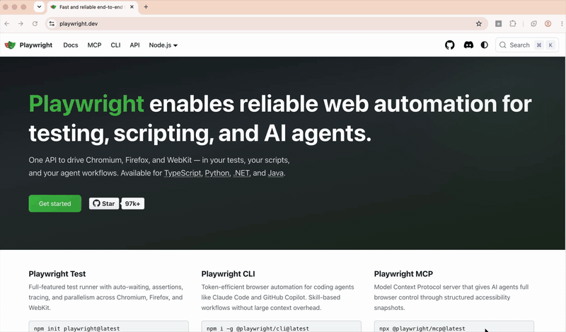

# eleminspect

**eleminspect** is a Chrome extension for test automation and web scraping. Hover over any element on a page, lock it, and get the locators you can use in your tests: unique IDs, roles, text, CSS selectors, and XPath. Every locator shown has been checked to match only that one element on the page.



Full demo video on YouTube: [youtu.be/LZ6M5he3vOQ](https://youtu.be/LZ6M5he3vOQ)

## Features

- **Unique locators only.** Every suggestion is verified against the live page. If a locator matches more than one element, it is not shown.
- **Many locator types.** Unique ID, test IDs (`data-testid` and similar), role with accessible name, label, placeholder, alt text, visible text, name, title, data attributes, CSS, and XPath.
- **Smart XPath.** You get one XPath per element: the shortest unique path relative to a nearby element with a unique ID or test ID, using axes such as `following-sibling`, `ancestor`, and `contains()`, `starts-with()`, `normalize-space()` for unstable values. If no such anchor exists, it falls back to the absolute path from `/html[1]/body[1]/...`.
- **Highlight to verify.** Click the highlight button next to any locator and the element blinks on the page, so you can see exactly what the locator points to.
- **Safe inspection.** While the inspector is active, clicks, mouse presses, and key presses do not reach the page. Opening a dropdown, pressing a button, or following a link while inspecting will not trigger it.
- **Copy with one click.** Each locator has a Copy button.
- **Works from the toolbar or DevTools.** Use the extension popup, or the **eleminspect** tab in Chrome DevTools.

## Install

1. Go to the [latest release](https://github.com/techietrends23/eleminspect/releases/latest) and download `eleminspect.zip`.
2. Unzip it.
3. Open `chrome://extensions`, turn on **Developer mode**, then click **Load unpacked** and select the unzipped folder.

## Usage

1. Open the page you want to inspect.
2. Click the eleminspect icon and press **Inspect element**, or open DevTools and use the **eleminspect** panel.
3. Hover over elements. The panel lists the unique locators for the element under the pointer.
4. Click to lock the element. Use **Copy** to copy a locator, or the highlight button to blink the element on the page.
5. Press **Esc** or **Stop inspecting** to exit.

## Build from source

The extension has no build step beyond packaging. `scripts/build-extension.js` creates `dist/eleminspect.zip` (unpacked install) and `dist/eleminspect.crx` (signed package).

```bash
npm install --prefix .build-tools crx@5.0.1
EXTENSION_PEM_FILE=/path/to/extension-key.pem node scripts/build-extension.js
```

The signing key is never stored in the repo. Keep your `.pem` file private.

Every push to `main` runs the **Build eleminspect extension** workflow in `.github/workflows/build-extension.yml`. The workflow builds the package and replaces the `latest` release.

## Project layout

| File | Purpose |
| --- | --- |
| `manifest.json` | Extension manifest (Manifest V3) |
| `content-script.js` | Inspector UI, page blocking, locator highlight |
| `selector-generator.js` | Builds and checks locators, including the XPath logic |
| `element-check-catalog.js` | Element snapshot helpers used for checks |
| `locator-match.js` | Resolves locator values to matching elements |
| `inspector-controls.js` | Start and stop logic shared by the popup and DevTools panel |
| `popup.html`, `popup.js` | Toolbar popup |
| `devtools.html`, `devtools.js`, `devtools-panel.*` | DevTools panel |
| `xpath.md` | XPath reference used when designing the locator rules |

## Limitations

- Only the top frame of a page can be inspected. Elements inside `<iframe>` elements are not shown.
- Elements inside shadow DOM are not reachable by CSS or XPath, so they are not listed.
- While inspecting, the mouse wheel scrolls the page, but scrolling inside a nested scroll container may not work.
- Pages that do not allow content scripts, such as the Chrome Web Store and `chrome://` pages, cannot be inspected.

## License

No license has been chosen yet.
